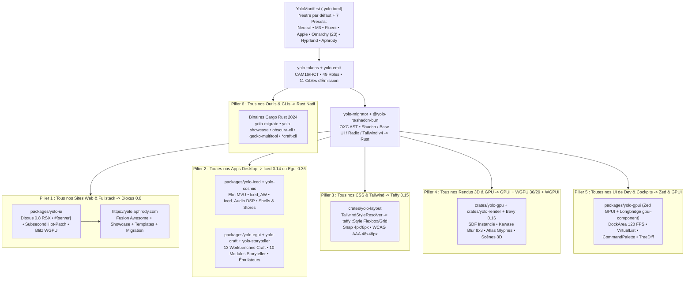

# Plan Directeur d'Unification & Migration Rust (`yolo.aphrody.com`)

Ce document établit l'architecture cible et le plan de migration complet de l'ensemble de nos dépôts (`yolo-ui`, `bun-os`, `bun-ui`, `yolo-web`, `rosegriffon`, `shenron`, `wii-os`, `aphrody-infra-shenron`, `FCMCP`, `auto`, `ft`) vers l'écosystème Rust unifié **Yolo UI (`yolo-rs/yolo-ui`)**, ainsi que la fusion de tous nos catalogues **Awesome**, **Showcases** et **Starter Templates** au sein d'un seul portail : **`https://yolo.aphrody.com`** ([`apps/yolo-showcase/src/site_hub.rs`](file:///C:/src/yolo-ui/apps/yolo-showcase/src/site_hub.rs)).

---

## 1. Vue d'Ensemble de l'Architecture Cible (Les 6 Piliers)



---

## 2. Pilier 1 — Migration de Tous nos Sites Web vers Dioxus 0.8 (`packages/yolo-ui`)

Tous les sites Next.js, React, Vite, Astro et Storybook sont consolidés sous **Dioxus 0.8 Fullstack (`SSR` + `WASM` + `Server Functions #[server]` + `Subsecond` hot-patching + rendu `Blitz`)** via le compilateur [`crates/yolo-migrator`](file:///C:/src/yolo-ui/crates/yolo-migrator/src/lib.rs) (`bun run ui migrate <entry.tsx> --target dioxus`).

| Site / Application Source | Dépôt Actuel | Stack Legacy | Architecture Cible Dioxus 0.8 (`yolo-ui`) | Preset Thème |
| :--- | :--- | :--- | :--- | :--- |
| **`yolo.aphrody.com`** | [`apps/yolo-showcase`](file:///C:/src/yolo-ui/apps/yolo-showcase/src/site_hub.rs) | Showcases & docs dispersés | **Portail Unifié Dioxus 0.8** (`/showcase`, `/awesome`, `/templates`, `/migration`) | `yolo-neutral` (commutable vers les 7 presets) |
| **`aphrody-web` & `m3-web`** | `bun-os/apps/aphrody-web`, `bun-ui/apps/m3-web` | Next.js 15 + React + Tailwind | Dioxus 0.8 Fullstack SSR + `yolo-tokens` M3 / Byron Love | `yolo-aphrody` / `yolo-m3` |
| **Les 13 `*craft-web`** (`word`, `grid`, `deck`, `pdf`, `photo`, `vector`, `light`, `film`, `effect`, `sound`, `design`, `fig`, `cad`) | `bun-os/apps/*craft-web` | React + Vite wrappers | Coquille Dioxus 0.8 Web/WASM embarquant le canevas WGPU/Egui de [`yolo-craft`](file:///C:/src/yolo-ui/crates/yolo-craft/src/lib.rs) | `yolo-neutral` |
| **`iecode-web` / `iecode-web-wasm` / `iecode-web-wii-wasm`** | `bun-os/apps/iecode-web*` | TypeScript + WebGL / WASM | Dioxus 0.8 WASM + Viewport WGPUI Level-5 / Inazuma Eleven | `yolo-aphrody` |
| **`rg-website` & `azalee-web`** | `rosegriffon/apps/rg-website`, `azalee-web` | Next.js + Shadcn UI + Radix | Dioxus 0.8 Fullstack migré via `yolo-migrator` (`--target dioxus`) | `yolo-aphrody` |
| **`shenron-site` & `shenron-activity`** | `shenron/apps/site`, `shenron/apps/activity` | React + Discord Activity SDK | Dioxus 0.8 LiveView / WASM + 23 palettes `OmarchySubTheme` | `yolo-omarchy` |
| **`auto-web` & `auto-admin`** | `auto/apps/web`, `auto/apps/admin` | React + Shadcn + TanStack | Dioxus 0.8 Fullstack + `yolo-contracts` DataTable/Forms | `yolo-fluent` |
| **`ft-home` & `ft-design-system`** | `ft/apps/home`, `ft/apps/design-system` | React + Storybook | Dioxus 0.8 + fusion directe dans `yolo.aphrody.com/showcase` | `yolo-apple` |

---

## 3. Pilier 2 — Migration de Toutes nos Apps Desktop vers Iced 0.14 ou Egui 0.36

### Règle de décision architecturale : Iced vs Egui
- **Iced 0.14 & System76 `libcosmic` ([`packages/yolo-iced`](file:///C:/src/yolo-ui/packages/yolo-iced/src/lib.rs) & [`packages/yolo-cosmic`](file:///C:/src/yolo-ui/packages/yolo-cosmic/src/lib.rs))** : Applications Desktop **Retained-Mode (Elm MVU)** — shells système, stores d'applications, gestionnaires de fichiers, lecteurs multimédias/DSP et panneaux de configuration.
- **Egui 0.36 ([`packages/yolo-egui`](file:///C:/src/yolo-ui/packages/yolo-egui/src/lib.rs), [`crates/yolo-craft`](file:///C:/src/yolo-ui/crates/yolo-craft/src/lib.rs), [`crates/yolo-storyteller`](file:///C:/src/yolo-ui/crates/yolo-storyteller/src/lib.rs))** : Applications Desktop **Immediate-Mode (60–240 FPS)** — les 13 workbenches créatifs Craft, les 10 modules narratifs Storyteller, les éditeurs nodaux, la CAO, les DAWs et les débogueurs d'émulateurs.

| Application Desktop | Dépôt Source | Cible Rust Desktop | Crate / Bridge Yolo UI | Preset Thème |
| :--- | :--- | :--- | :--- | :--- |
| **`bunos-win11-chrome` & `desktop` shell** | `bun-os/crates/bunos-win11-chrome` | **Iced 0.14 + libcosmic** | [`packages/yolo-iced`](file:///C:/src/yolo-ui/packages/yolo-iced/src/lib.rs) + [`packages/yolo-cosmic`](file:///C:/src/yolo-ui/packages/yolo-cosmic/src/lib.rs) | `yolo-fluent` |
| **`craft-hub` & `bunos-flutter-store`** | `bun-os/apps/craft-hub` | **Iced 0.14 Elm MVU** | [`packages/yolo-iced`](file:///C:/src/yolo-ui/packages/yolo-iced/src/lib.rs) (`IcedTheme` + `iced_aw`) | `yolo-m3` |
| **`spacedrive` & `spotcraft`** | `bun-os/apps/spacedrive`, `spotcraft` | **Iced 0.14 + `iced_audio` DSP** | [`packages/yolo-iced`](file:///C:/src/yolo-ui/packages/yolo-iced/src/lib.rs) (`FreqRange`, `FaderConfig`, `Comet`) | `yolo-apple` |
| **`wii-os/menu-native` & `auto/desktop`** | `wii-os/apps/menu-native`, `auto/apps/desktop` | **Iced 0.14 Multi-Window** | [`packages/yolo-iced`](file:///C:/src/yolo-ui/packages/yolo-iced/src/lib.rs) + shader pass WGPU | `yolo-hyprland` |
| **Les 13 Workbenches Craft** (`Word`, `Grid`, `Deck`, `Pdf`, `Photo`, `Vector`, `Light`, `Film`, `Effect`, `Sound`, `Design`, `Fig`, `Cad`) | `bun-os/apps/*craft` | **Egui 0.36 + `yolo-craft`** | [`packages/yolo-egui`](file:///C:/src/yolo-ui/packages/yolo-egui/src/lib.rs) + [`crates/yolo-craft`](file:///C:/src/yolo-ui/crates/yolo-craft/src/lib.rs) (`DockArea`) | `yolo-neutral` |
| **Les 10 Modules Storyteller** (`Dashboard`, `Timeline`, `Graph`, `Lore`, `Character`, `Storyboard`, `Comic`, `Novel`, `Dialogue`, `Prompt`) | [`crates/yolo-storyteller`](file:///C:/src/yolo-ui/crates/yolo-storyteller/src/lib.rs) | **Egui 0.36 + `yolo-storyteller`** | [`crates/yolo-storyteller`](file:///C:/src/yolo-ui/crates/yolo-storyteller/src/lib.rs) + `CharacterSheet::byron_love()` | `yolo-aphrody` |
| **Émulateurs (`gecko-debugger`, `aphrody-ctr-desktop`, `ruzu`)** | `wii-os`, `bun-os` | **Egui 0.36 + Puffin Profiler** | [`packages/yolo-egui`](file:///C:/src/yolo-ui/packages/yolo-egui/src/lib.rs) (`puffin` hook + inspecteurs mémoire) | `yolo-omarchy` |

---

## 4. Pilier 3 — Migration de Tous nos CSS & Tailwind v4 vers Taffy 0.15 (`crates/yolo-layout`)

Plus aucun moteur CSS navigateur ni pipeline PostCSS/Node.js n'est requis pour calculer la géométrie :
1. **Compilation Tailwind v4 -> `taffy::Style`** : [`TailwindStyleResolver::resolve_classes`](file:///C:/src/yolo-ui/crates/yolo-layout/src/tailwind.rs) convertit les utilitaires Flexbox/Grid/Spacing/Sizing (`flex`, `grid-cols-*`, `gap-*`, `p-*`, `w-*`, `h-*`, `items-*`, `justify-*`) directement en structures `taffy::Style` typées.
2. **Arbre de Layout Unifié (`YoloLayoutTree`)** : [`crates/yolo-layout/src/lib.rs`](file:///C:/src/yolo-ui/crates/yolo-layout/src/lib.rs) exécute l'algorithme Flexbox & CSS Grid de **Taffy 0.15** (`submodules/taffy`) pour Dioxus Blitz, GPUI, Iced, Egui et WGPU.
3. **Snap Grille 4px/8px & Accessibilité WCAG AAA** :
   - `snap_to_grid(rect, 4.0)` / `snap_to_grid(rect, 8.0)` aligne chaque boîte sur la grille matérielle du preset actif.
   - `enforce_min_touch_target(rect)` garantit une cible interactive minimale de **48×48 px** conformément à [`crates/yolo-contracts`](file:///C:/src/yolo-ui/crates/yolo-contracts/src/lib.rs).

---

## 5. Pilier 4 — Migration de Tous nos Rendus 3D & Shaders vers GPUI + WGPU 30/29 + WGPUI

Tous les moteurs de rendu 3D/2D disparates (`Three.js`, `WebGL`, anciens `wgpu 0.19/0.20`) convergent vers la pile **GPUI + WGPU 30/29 + WGPUI ([`crates/yolo-gpu`](file:///C:/src/yolo-ui/crates/yolo-gpu/src/lib.rs) + [`crates/yolo-render`](file:///C:/src/yolo-ui/crates/yolo-render/src/lib.rs) + [`packages/yolo-gpui`](file:///C:/src/yolo-ui/packages/yolo-gpui/src/lib.rs) + `submodules/bevy` 0.16)** :

- **Primitives SDF Analytiques Instanciées (`yolo-render` + `yolo-gpu`)** : Rendu GPU anti-aliasé en un seul draw call pour les squircles Apple (`radius=10px`), les bordures actives Hyprland (`#33CCFF -> #00FF99` à `45deg`), les ombres portées et l'atlas de glyphes (`cosmic-text` + `etagere`).
- **Effets de Verre & Flou Kawase (`8×3` passes)** : Implémentation native dans [`crates/yolo-render`](file:///C:/src/yolo-ui/crates/yolo-render/src/lib.rs) pour `Liquid Glass` (Apple), `Mica/Acrylic` (Fluent) et `Kawase Dual-Filter` (Hyprland).
- **Scènes 3D & Viewports Embarqués (`WGPUI`)** :
  - `aphrody-model-view`, `aphrody-nie-render3d` (modèles 3D Level-5 / Inazuma Eleven) et `aphrody-tauri-3d` -> surface WGPU 30/29 intégrée dans un panneau `yolo-gpui` / `yolo-egui`.
  - `gecko-backend-wgpu` (Wii/GameCube GX -> WGPU 30/29) & `aphrody-dust-wgpu` (NDS 3D -> WGPU 30/29) -> pipeline `yolo-gpu` partagé.
  - `vectorcraft-three-d` & **Byron Love 8×11 Sprite/3D Stage** (`192×208` cellules, 10 teintes Oklch `#F7F3F0`..`#131420`) -> rendu direct `yolo-gpu`.

---

## 6. Pilier 5 — Migration de Toutes nos UI de Dev & Cockpits vers Zed & GPUI (`packages/yolo-gpui`)

Tous nos outils développeurs, dashboards d'agents, explorateurs de graphes de code, terminaux et inspecteurs MCP sont unifiés sous **Zed GPUI (`submodules/zed`) + Longbridge `gpui-component` (`submodules/gpui-component`)** via [`packages/yolo-gpui`](file:///C:/src/yolo-ui/packages/yolo-gpui/src/lib.rs) :

| Outil de Dev / Cockpit Source | Dépôt Actuel | Architecture Cible Zed & GPUI (`packages/yolo-gpui`) |
| :--- | :--- | :--- |
| **`aphrody-agent-home` & `ai-agent-runner`** | `bun-os/crates/aphrody-agent-home`, `yolo-web/apps/ai-agent-runner` | **Zed GPUI Multi-Agent Cockpit** (`DockArea` + `VirtualList` 120 FPS + streaming d'événements) |
| **`aphrody-code-graph` & `aphrody-pe-inspect`** | `bun-os/crates/aphrody-code-graph`, `aphrody-nie-pe-inspect` | **Zed GPUI Code Graph & Disassembly Inspector** (`TreeDiff` + `SplitPane` + WGPUI Node Canvas) |
| **`aphrody-term` & `bunos-wsl`** | `bun-os/crates/aphrody-term`, `bunos-wsl` | **Zed GPUI Terminal Multiplexer** (Alacritty/Zed terminal grid + thème `yolo-omarchy`) |
| **`ft/apps/mcp` & `FCMCP`** | `ft/apps/mcp`, `FCMCP` | **Zed GPUI MCP Inspector Studio** (`CommandPalette` + testeur live des 9 outils `@yolo-rs/ui-mcp`) |
| **`shenron-cockpit` & `aphrody-infra-shenron`** | `shenron`, `aphrody-infra-shenron` | **Zed GPUI Cluster & Telemetry Studio** (métriques GPU/CPU temps réel + journaux structurés) |

---

## 7. Pilier 6 — Migration de Tous nos Outils & CLIs vers Rust Natif

Tous les scripts et CLIs historiques en Node.js, Python ou C# (`.NET`) sont remplacés par des **binaires Cargo Rust 2024 natifs** pilotés par `just` et `bun run ui` :

1. **`yolo-migrate` ([`crates/yolo-migrator/src/main.rs`](file:///C:/src/yolo-ui/crates/yolo-migrator/src/main.rs))** : Compilateur natif OXC AST convertissant les composants TSX/JSX Shadcn, Base UI, Radix et Tailwind v4 vers Dioxus, WGPU, Egui, Cosmic, GTK4 et QML.
2. **`yolo-showcase` ([`apps/yolo-showcase/src/main.rs`](file:///C:/src/yolo-ui/apps/yolo-showcase/src/main.rs))** : Binaire multi-moteur vérifiant les 9 toolkits, les 7 presets, les 23 thèmes Omarchy, les 13 workbenches Craft, les 10 modules Storyteller, et générant le portail **`yolo.aphrody.com`** (`--emit-site`).
3. **Les 14 `*craft-cli` & `aphrody-nie-cli`** : Remplacement définitif de `iecode-dotnet` (C#) et des wrappers JS par des binaires Rust natifs.
4. **`obscura-cli` (`yolo-web`) & `gecko-multitool` (`wii-os`)** : Outils d'inspection web/CDP et de rétro-ingénierie compilés avec le profil Cargo `release` optimisé (`lto = "thin"`, `codegen-units = 1`).

---

## 8. Fusion Awesome + Showcase + Templates en un Seul Site : `yolo.aphrody.com`

Le portail unique **`https://yolo.aphrody.com`** ([`apps/yolo-showcase/src/site_hub.rs`](file:///C:/src/yolo-ui/apps/yolo-showcase/src/site_hub.rs)) fusionne en une seule application et un seul bundle :

1. **`/showcase` — Showcase Interactif Multi-Moteur & 7 Thèmes** :
   - Commutation en direct entre les **7 `YoloThemePreset`s** (`yolo-neutral` par défaut, `yolo-m3`, `yolo-fluent`, `yolo-apple`, `yolo-omarchy` + 23 sous-thèmes, `yolo-hyprland`, `yolo-aphrody` + Byron Love `8×11`).
   - Démonstrateur des **13 Workbenches Craft** et des **10 Modules Storyteller**.
2. **`/migration` — Matrice Interactive des 6 Piliers** :
   - Suivi complet des 21 familles d'applications migrées vers Dioxus 0.8, Iced 0.14, Egui 0.36, Taffy 0.15, WGPUI 24, Zed GPUI et Rust Natif.
3. **`/templates` — Les 8 Starter Templates Officiels** :
   - `dioxus-fullstack-site`, `iced-desktop-mvu`, `egui-craft-workbench`, `zed-gpui-devtool`, `wgpui-3d-viewport`, `taffy-tailwind-layout`, `rust-native-cli`, `tauri-v3-hybrid`.
4. **`/awesome` — Awesome Ecosystem Hub (124 Sous-modules `yolo-rs/*`)** :
   - Regroupement des 9 grandes familles Awesome (`awesome-gpui`, `awesome-dioxus`, `awesome-iced`, `awesome-egui`, `awesome-wgpu-bevy`, `awesome-tauri`, `awesome-design-systems`, `awesome-shadcn-tailwind-rust`, `awesome-react-expo-bun-rust`).

### Commandes Unifiées
```bash
# Afficher le plan directeur de migration (ou filtrer par pilier : sites, iced, egui, taffy, wgpui, gpui, rust-cli)
bun run ui plan
bun run ui plan --pillar gpui

# Générer et vérifier le portail unifié yolo.aphrody.com (dans dist/yolo-aphrody-com/index.html)
bun run ui site
cargo run -p yolo-showcase -- --emit-site dist/yolo-aphrody-com
```
