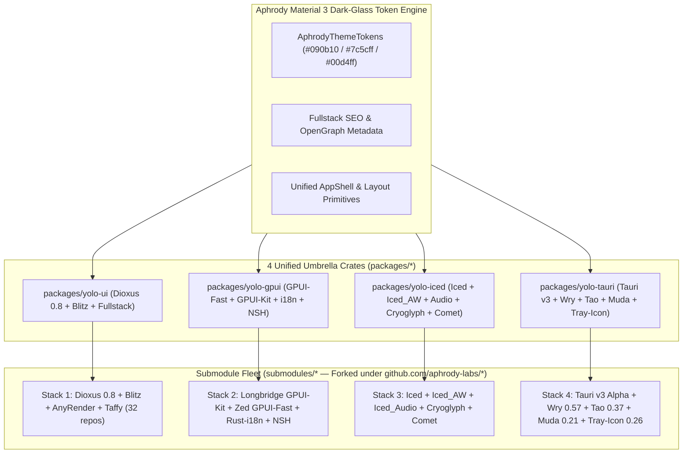

# 00: Monorepo and multi-engine fleet architecture (`aphrody-labs/yolo-ui`)

`aphrody-labs/yolo-ui` is the Aphrody Labs monorepo for multi-engine Rust UI, fullstack web, native GPU desktop, and mobile applications. It combines four Rust UI/application stacks and five upstream open-source ecosystems (`dioxuslabs`, `longbridge`, `zed-industries`, `iced-rs`, `tauri-apps`) in a single Cargo workspace (`Edition 2024`, `resolver = "2"`). An upstream Bun v1.4.4+ toolchain handles orchestration and optimization.

## 1. Multi-engine architecture overview

## 2. The four engine pillars

### Pillar 1: Dioxus 0.8 + Blitz + AnyRender + Taffy (`packages/yolo-ui`)

Target workloads: fullstack web apps with SSR and hydration, WASM SPAs, LiveView WebSocket apps, and native GPU apps with CSS layout.

| Layer                      | Crates / submodules                                                                                                                              | Responsibility                                                                                                                   |
| :------------------------- | :----------------------------------------------------------------------------------------------------------------------------------------------- | :------------------------------------------------------------------------------------------------------------------------------- |
| Umbrella                   | `packages/yolo-ui`, `packages/dioxus`                                                                                                            | Re-exports Dioxus 0.8, `APHRODY_DARK_THEME`, `SiteMeta` SEO, `AppShell`, Primitives, Icons, SDK, and RSRPC                       |
| Core reactivity & VDOM     | `packages/core`, `packages/vdom`, `packages/signals`, `packages/stores`, `packages/hooks`, `packages/rsx`                                        | Generational-box reactive signals, VirtualDOM diffing, and `rsx!` compile-time template generation                               |
| Fullstack & routing        | `packages/fullstack`, `packages/fullstack-server`, `packages/ssr`, `packages/router`, `submodules/rsrpc`                                         | Axum SSR, streaming suspense, markerless hydration, `#[server]` RPC macros, and type-safe `#[derive(Routable)]`                  |
| Native HTML/CSS engine     | `submodules/blitz`, `submodules/anyrender`, `submodules/dioxus-taffy`, `submodules/taffy`                                                        | Stylo CSS cascade + Taffy Flexbox/Grid layout + AnyRender (Vello GPU / Vello CPU / Vello Hybrid / Skia / SVG)                    |
| Design primitives & DX     | `submodules/dioxus-components`, `submodules/dioxus-icons`, `submodules/dioxus-code`, `submodules/sdk`, `packages/subsecond`, `packages/manganis` | Accessible WAI-ARIA primitives, Lucide icons, syntax-highlighted code editor, hot-patching (`subsecond`), and `asset!()` bundler |

### Pillar 2: Longbridge GPUI-Kit + Zed GPUI-Fast + Rust-i18n + NSH (`packages/yolo-gpui`)

Target workloads: low-latency, 120fps+ GPU-accelerated professional desktop applications, code editors, trading terminals, AI workbenches, and native shells.

| Layer                        | Crates / submodules                                      | Responsibility                                                                                                                      |
| :--------------------------- | :------------------------------------------------------- | :---------------------------------------------------------------------------------------------------------------------------------- |
| Umbrella                     | `packages/yolo-gpui`                                     | Unified Aphrody Labs GPUI facade with dark-glass theme bridge, localization helpers, and workspace shell layout                     |
| GPU UI runtime               | `submodules/gpui-fast` (`zed-industries` fork)           | Hybrid immediate/retained-mode GPU UI engine (Metal, DirectX 12, Vulkan/Blade) with entity-component state and custom shaders       |
| Pro component kit            | `submodules/gpui-kit` (`longbridge/gpui-component` fork) | 60+ high-density desktop widgets: dockable panels, virtualized tables, command palettes, charts, tree views, and multi-window docks |
| Internationalization         | `submodules/rust-i18n` (`longbridge/rust-i18n` fork)     | Compile-time YAML/JSON/TOML locale codegen (`t!()` macro) for zero-overhead multi-language desktop/web UIs                          |
| Native shell integration     | `submodules/nsh` (`longbridge/nsh` fork)                 | Embedded terminal/shell execution, command completion, and PTY session orchestration                                                |

### Pillar 3: Iced + Iced_AW + Iced_Audio + Cryoglyph + Comet (`packages/yolo-iced`)

Target workloads: type-safe desktop utilities on the Elm architecture (Model-View-Update), audio/DSP synthesizers and DAWs, COSMIC-style system applets, and custom WGPU shaders.

| Layer                    | Crates / submodules                                 | Responsibility                                                                                                |
| :----------------------- | :-------------------------------------------------- | :------------------------------------------------------------------------------------------------------------ |
| Umbrella                 | `packages/yolo-iced`                                | Aphrody Dark-Glass `iced::Theme` palette provider, MVU application shell, and widget re-exports               |
| Core MVU engine          | `submodules/iced` (`iced-rs/iced` fork)             | Elm-inspired `Task`/`Element`/`Subscription` reactive architecture over WGPU and Tiny-Skia                    |
| Extended widgets         | `submodules/iced_aw` (`iced-rs/iced_aw` fork)       | Modals, tabs, date/time pickers, color pickers, badges, split panes, context menus, and number inputs         |
| Audio / DSP controls     | `submodules/iced_audio` (`iced-rs/iced_audio` fork) | Rotary knobs, vertical/horizontal faders, XY pads, frequency ramps, and decibel meters for pro-audio UIs      |
| GPU text & toolkit       | `submodules/cryoglyph`, `submodules/comet`          | WGPU glyph atlas text renderer (`cryoglyph`) and experimental declarative layout/styling extensions (`comet`) |

### Pillar 4: Tauri v3 Alpha + Wry 0.57 + Tao 0.37 + Muda 0.21 + Tray-Icon 0.26 (`packages/yolo-tauri`)

Target workloads: lightweight cross-platform application shells for desktop and mobile (iOS/Android), OS windowing, native menus, system trays, and IPC hosts with multiple webviews.

| Layer                   | Crates / submodules                                                                                                 | Responsibility                                                                                                   |
| :---------------------- | :------------------------------------------------------------------------------------------------------------------ | :--------------------------------------------------------------------------------------------------------------- |
| Umbrella                | `packages/yolo-tauri`                                                                                               | Pre-configured Tauri v3 / Wry / Tao window builder, native menu & system tray presets, and Dioxus/Webview bridge |
| Application runtime     | `submodules/tauri` (v3.0.0-alpha), `submodules/plugins-workspace`, `submodules/Cargo-mobile2`                       | Fine-grained capability security (ACL), typed IPC commands/channels, and iOS/Android mobile packaging            |
| WebView engine          | `submodules/wry` (v0.57.0)                                                                                          | Cross-platform WebView abstraction over WebView2 (Windows), WKWebView (macOS/iOS), and WebKitGTK (Linux)         |
| OS windowing & loop     | `submodules/tao` (v0.37.0), `submodules/window-vibrancy`, `submodules/window-shadows`, `submodules/dpi`             | Window creation, multi-monitor DPI scaling, Mica/Acrylic/vibrancy glass effects, and raw event loop              |
| Native menus & tray     | `submodules/muda` (v0.21.0), `submodules/tray-icon` (v0.26.0), `submodules/global-hotkey`, `submodules/accelerator` | Native OS menu bars, context menus, system tray icons, and global keyboard shortcuts                             |

## 3. Bun v1.4.4+ toolchain and scripts

Repository automation, submodule synchronization, Cargo workspace verification, and compiler profile auditing all run through upstream Bun v1.4.4+:

| Command                              | Script                            | Description                                                                                                                                      |
| :----------------------------------- | :-------------------------------- | :----------------------------------------------------------------------------------------------------------------------------------------------- |
| `bun run fleet:status`               | `scripts/fleet.ts status`         | Displays all submodules grouped by upstream stack (`dioxuslabs`, `longbridge`, `zed-industries`, `iced-rs`, `tauri-apps`) and current commit SHA |
| `bun run fleet:sync`                 | `scripts/fleet.ts sync`           | Initializes and shallow-updates (`--depth 1`) all submodules in `submodules/*`                                                                   |
| `bun run fleet:inventory`            | `scripts/fleet.ts inventory`      | Generates `fleet.json` with machine-readable metadata for every submodule in the monorepo                                                        |
| `bun run build`                      | `scripts/build.ts check`          | Runs `cargo metadata` and fast `cargo check` across all available umbrella crates (`yolo-ui`, `yolo-gpui`, `yolo-iced`, `yolo-tauri`, `dioxus`)  |
| `bun run build:release`              | `scripts/build.ts release`        | Builds optimized release artifacts for the umbrella crates                                                                                       |
| `bun run test`                       | `bun test && bun scripts/test.ts` | Runs the Bun TypeScript verification suite (`tests/monorepo.test.ts`) followed by Rust unit tests across the umbrella crates                     |
| `bun run optimize`                   | `scripts/optimize.ts`             | Audits `Cargo.toml` workspace members, `[workspace.dependencies]` deduplication, and `[profile.*]` compiler flags                                |
| `bun check` / `bun fmt` / `bun lint` | Native Bun CLI                    | Runs TypeScript 7 (`tsgo`) typechecking, Prettier-compatible formatting, and linting                                                             |

## 4. Cargo workspace and compiler optimization profiles

The root `Cargo.toml` enforces shared dependency versions through `[workspace.dependencies]` and defines compiler profiles for specific uses:

- `[profile.dev]` sets `debug = "line-tables-only"`, which cuts PDB/DWARF artifact sizes and link times and still keeps `file:line` stack traces. Hot inner crates (`walrus`, `dioxus-vdom-fuzz`) compile at `opt-level = 3`.
- `[profile.release]` enables `incremental = true` so repeated release checks rebuild faster.
- `[profile.release-max-opt]` enables `lto = true` and `codegen-units = 1` for the fastest production binaries.
- `[profile.wasm-split-release]` sets `opt-level = 'z'`, `lto = true`, and `debug = true` so `wasm-opt` and `wasm-split-cli` produce small, code-split WebAssembly bundles.
- `[profile.cli-release-dev]` combines `opt-level = 3` and `incremental = true` for quick `dx` CLI builds.
