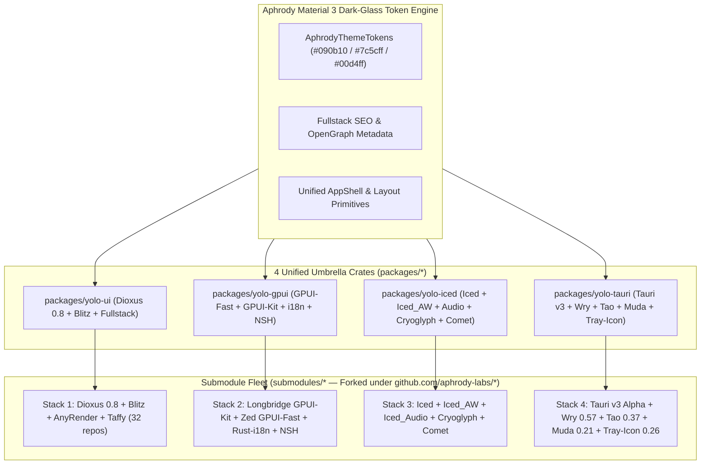

# 00 — Master Monorepo & Multi-Engine Fleet Architecture (`aphrody-labs/yolo-ui`)

`aphrody-labs/yolo-ui` is the unified, multi-engine Rust UI, Fullstack Web, Native GPU Desktop, and Mobile Application monorepo for Aphrody Labs. It consolidates **four foundational Rust UI/application stacks** and **five upstream open-source ecosystems** (`dioxuslabs`, `longbridge`, `zed-industries`, `iced-rs`, `tauri-apps`) into a single Cargo workspace (`Edition 2024`, `resolver = "2"`) managed by an **Upstream Bun v1.4.4+** orchestration and optimization toolchain.

---

## 1. High-Level Multi-Engine Architecture

---

## 2. The Four Engine Pillars

### Pillar 1: Dioxus 0.8 + Blitz + AnyRender + Taffy (`packages/yolo-ui`)

**Target Workloads**: Fullstack SSR + Hydration Web Apps, WASM SPAs, LiveView WebSocket Apps, and CSS-Layout GPU Native Apps.

| Layer                      | Crates / Submodules                                                                                                                              | Responsibility                                                                                                                   |
| :------------------------- | :----------------------------------------------------------------------------------------------------------------------------------------------- | :------------------------------------------------------------------------------------------------------------------------------- |
| **Umbrella**               | `packages/yolo-ui`, `packages/dioxus`                                                                                                            | Re-exports Dioxus 0.8, `APHRODY_DARK_THEME`, `SiteMeta` SEO, `AppShell`, Primitives, Icons, SDK, and RSRPC                       |
| **Core Reactivity & VDOM** | `packages/core`, `packages/vdom`, `packages/signals`, `packages/stores`, `packages/hooks`, `packages/rsx`                                        | Generational-box reactive signals, VirtualDOM diffing, and `rsx!` compile-time template generation                               |
| **Fullstack & Routing**    | `packages/fullstack`, `packages/fullstack-server`, `packages/ssr`, `packages/router`, `submodules/rsrpc`                                         | Axum SSR, streaming suspense, markerless hydration, `#[server]` RPC macros, and type-safe `#[derive(Routable)]`                  |
| **Native HTML/CSS Engine** | `submodules/blitz`, `submodules/anyrender`, `submodules/dioxus-taffy`, `submodules/taffy`                                                        | Stylo CSS cascade + Taffy Flexbox/Grid layout + AnyRender (Vello GPU / Vello CPU / Vello Hybrid / Skia / SVG)                    |
| **Design Primitives & DX** | `submodules/dioxus-components`, `submodules/dioxus-icons`, `submodules/dioxus-code`, `submodules/sdk`, `packages/subsecond`, `packages/manganis` | Accessible WAI-ARIA primitives, Lucide icons, syntax-highlighted code editor, hot-patching (`subsecond`), and `asset!()` bundler |

---

### Pillar 2: Longbridge GPUI-Kit + Zed GPUI-Fast + Rust-i18n + NSH (`packages/yolo-gpui`)

**Target Workloads**: Ultra-low-latency 120fps+ GPU-accelerated Pro Desktop Applications, Code Editors, Trading Terminals, AI Workbenches, and Native Shells.

| Layer                        | Crates / Submodules                                      | Responsibility                                                                                                                      |
| :--------------------------- | :------------------------------------------------------- | :---------------------------------------------------------------------------------------------------------------------------------- |
| **Umbrella**                 | `packages/yolo-gpui`                                     | Unified Aphrody Labs GPUI facade with dark-glass theme bridge, localization helpers, and workspace shell layout                     |
| **GPU UI Runtime**           | `submodules/gpui-fast` (`zed-industries` fork)           | Hybrid immediate/retained-mode GPU UI engine (Metal, DirectX 12, Vulkan/Blade) with entity-component state and custom shaders       |
| **Pro Component Kit**        | `submodules/gpui-kit` (`longbridge/gpui-component` fork) | 60+ high-density desktop widgets: dockable panels, virtualized tables, command palettes, charts, tree views, and multi-window docks |
| **Internationalization**     | `submodules/rust-i18n` (`longbridge/rust-i18n` fork)     | Compile-time YAML/JSON/TOML locale codegen (`t!()` macro) for zero-overhead multi-language desktop/web UIs                          |
| **Native Shell Integration** | `submodules/nsh` (`longbridge/nsh` fork)                 | Embedded terminal/shell execution, command completion, and PTY session orchestration                                                |

---

### Pillar 3: Iced + Iced_AW + Iced_Audio + Cryoglyph + Comet (`packages/yolo-iced`)

**Target Workloads**: Type-safe Elm-Architecture (Model-View-Update) Desktop Utilities, Audio/DSP Synthesizers & DAWs, COSMIC-style System Applets, and Custom WGPU Shaders.

| Layer                    | Crates / Submodules                                 | Responsibility                                                                                                |
| :----------------------- | :-------------------------------------------------- | :------------------------------------------------------------------------------------------------------------ |
| **Umbrella**             | `packages/yolo-iced`                                | Aphrody Dark-Glass `iced::Theme` palette provider, MVU application shell, and widget re-exports               |
| **Core MVU Engine**      | `submodules/iced` (`iced-rs/iced` fork)             | Elm-inspired `Task`/`Element`/`Subscription` reactive architecture over WGPU and Tiny-Skia                    |
| **Extended Widgets**     | `submodules/iced_aw` (`iced-rs/iced_aw` fork)       | Modals, tabs, date/time pickers, color pickers, badges, split panes, context menus, and number inputs         |
| **Audio / DSP Controls** | `submodules/iced_audio` (`iced-rs/iced_audio` fork) | Rotary knobs, vertical/horizontal faders, XY pads, frequency ramps, and decibel meters for pro-audio UIs      |
| **GPU Text & Toolkit**   | `submodules/cryoglyph`, `submodules/comet`          | WGPU glyph atlas text renderer (`cryoglyph`) and experimental declarative layout/styling extensions (`comet`) |

---

### Pillar 4: Tauri v3 Alpha + Wry 0.57 + Tao 0.37 + Muda 0.21 + Tray-Icon 0.26 (`packages/yolo-tauri`)

**Target Workloads**: Lightweight Cross-Platform Desktop & Mobile (iOS/Android) Application Shells, OS Windowing, Native Menus, System Trays, and Multi-Webview IPC Hosts.

| Layer                   | Crates / Submodules                                                                                                 | Responsibility                                                                                                   |
| :---------------------- | :------------------------------------------------------------------------------------------------------------------ | :--------------------------------------------------------------------------------------------------------------- |
| **Umbrella**            | `packages/yolo-tauri`                                                                                               | Pre-configured Tauri v3 / Wry / Tao window builder, native menu & system tray presets, and Dioxus/Webview bridge |
| **Application Runtime** | `submodules/tauri` (v3.0.0-alpha), `submodules/plugins-workspace`, `submodules/Cargo-mobile2`                       | Fine-grained capability security (ACL), typed IPC commands/channels, and iOS/Android mobile packaging            |
| **WebView Engine**      | `submodules/wry` (v0.57.0)                                                                                          | Cross-platform WebView abstraction over WebView2 (Windows), WKWebView (macOS/iOS), and WebKitGTK (Linux)         |
| **OS Windowing & Loop** | `submodules/tao` (v0.37.0), `submodules/window-vibrancy`, `submodules/window-shadows`, `submodules/dpi`             | Window creation, multi-monitor DPI scaling, Mica/Acrylic/vibrancy glass effects, and raw event loop              |
| **Native Menus & Tray** | `submodules/muda` (v0.21.0), `submodules/tray-icon` (v0.26.0), `submodules/global-hotkey`, `submodules/accelerator` | Native OS menu bars, context menus, system tray icons, and global keyboard shortcuts                             |

---

## 3. Unified Bun v1.4.4+ Toolchain & Scripts

All repository automation, submodule synchronization, Cargo workspace verification, and compiler profile auditing run through **Upstream Bun v1.4.4+**:

| Command                              | Script                            | Description                                                                                                                                      |
| :----------------------------------- | :-------------------------------- | :----------------------------------------------------------------------------------------------------------------------------------------------- |
| `bun run fleet:status`               | `scripts/fleet.ts status`         | Displays all submodules grouped by upstream stack (`dioxuslabs`, `longbridge`, `zed-industries`, `iced-rs`, `tauri-apps`) and current commit SHA |
| `bun run fleet:sync`                 | `scripts/fleet.ts sync`           | Initializes and shallow-updates (`--depth 1`) all submodules in `submodules/*`                                                                   |
| `bun run fleet:inventory`            | `scripts/fleet.ts inventory`      | Generates `fleet.json` with machine-readable metadata for every submodule in the monorepo                                                        |
| `bun run build`                      | `scripts/build.ts check`          | Runs `cargo metadata` and fast `cargo check` across all available umbrella crates (`yolo-ui`, `yolo-gpui`, `yolo-iced`, `yolo-tauri`, `dioxus`)  |
| `bun run build:release`              | `scripts/build.ts release`        | Builds optimized release artifacts for the umbrella crates                                                                                       |
| `bun run test`                       | `bun test && bun scripts/test.ts` | Runs the Bun TypeScript verification suite (`tests/monorepo.test.ts`) followed by Rust unit tests across the umbrella crates                     |
| `bun run optimize`                   | `scripts/optimize.ts`             | Audits `Cargo.toml` workspace members, `[workspace.dependencies]` deduplication, and `[profile.*]` compiler flags                                |
| `bun check` / `bun fmt` / `bun lint` | Native Bun CLI                    | Runs TypeScript 7 (`tsgo`) typechecking, Prettier-compatible formatting, and linting                                                             |

---

## 4. Cargo Workspace & Compiler Optimization Profiles

The root `Cargo.toml` enforces shared dependency versions via `[workspace.dependencies]` and provides purpose-built compiler profiles:

- **`[profile.dev]`**: Sets `debug = "line-tables-only"` to drastically reduce PDB/DWARF artifact sizes and link times while preserving `file:line` stack traces, with hot inner crates (`walrus`, `dioxus-vdom-fuzz`) compiled at `opt-level = 3`.
- **`[profile.release]`**: Enables `incremental = true` for fast iterative release verification.
- **`[profile.release-max-opt]`**: Enables `lto = true` and `codegen-units = 1` for maximum production binary performance.
- **`[profile.wasm-split-release]`**: Sets `opt-level = 'z'`, `lto = true`, and `debug = true` so `wasm-opt` and `wasm-split-cli` produce minimal, code-split WebAssembly bundles.
- **`[profile.cli-release-dev]`**: Combines `opt-level = 3` and `incremental = true` for responsive `dx` CLI builds.
