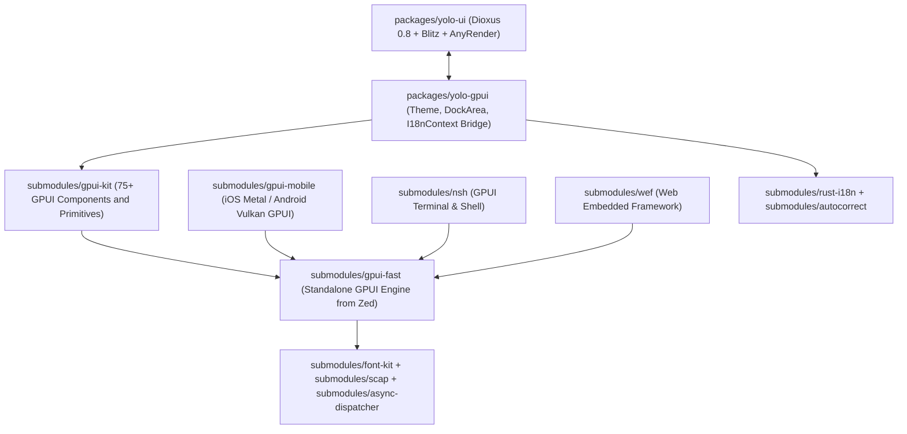

# GPUI and Longbridge stack architecture (`11-GPUI-LONGBRIDGE.md`)

Yolo UI brings the Zed GPUI (`zed-industries/*`) and Longbridge (`longbridge/*`) ecosystems together under `yolo-rs/*` submodules and the `packages/yolo-gpui` bridge crate. Both are GPU-accelerated and cover desktop, mobile, terminal, localization and embedded browser work.

## 1. Forked `yolo-rs/*` repository fleet (Longbridge and Zed Industries)

### Longbridge ecosystem (`longbridge/*` to `yolo-rs/*`)

| Upstream repository              | Aphrody Labs fork                  | Submodule path           | Role in Yolo UI                                                                                                                                                    |
| :------------------------------- | :--------------------------------- | :----------------------- | :----------------------------------------------------------------------------------------------------------------------------------------------------------------- |
| `longbridge/gpui-kit`            | `yolo-rs/gpui-kit`            | `submodules/gpui-kit`    | Rich desktop & workspace UI component kit for GPUI (DockArea, Panels, Tabs, Table, VirtualList, Tree, Charts, Markdown, CodeEditor, Theme, TitleBar, Modal/Drawer) |
| `longbridge/gpui-fast`           | `yolo-rs/gpui-fast`           | `submodules/gpui-fast`   | Fast-compiling standalone GPUI workspace extracted from Zed (`gpui`, `gpui_macros`, `collections`, `util`, `sum_tree`, `scheduler`, `http_client`, `refineable`)   |
| `longbridge/gpui-mobile`         | `yolo-rs/gpui-mobile`         | `submodules/gpui-mobile` | Cross-platform GPUI mobile backend targeting iOS (Metal/UIKit) and Android (Vulkan/GLES/JNI)                                                                       |
| `longbridge/nsh`                 | `yolo-rs/nsh`                 | `submodules/nsh`         | GPU-accelerated native shell & terminal emulator built on GPUI                                                                                                     |
| `longbridge/rust-i18n`           | `yolo-rs/rust-i18n`           | `submodules/rust-i18n`   | Compile-time codegen & runtime YAML/JSON/TOML localization (`t!` macro, pluralization, locale fallback)                                                            |
| `longbridge/wef`                 | `yolo-rs/wef`                 | `submodules/wef`         | Web Embedded Framework (CEF / Wry hybrid embedding for GPUI and native Rust windows)                                                                               |
| `longbridge/autocorrect`         | `yolo-rs/autocorrect`         | `submodules/autocorrect` | CJK + Latin copywriting linter and auto-spacer (`autocorrect`, `autocorrect-derive`, `autocorrect-lsp`)                                                            |
| `longbridge/openapi`             | `yolo-rs/longbridge-openapi`  | _(on-demand)_            | Longbridge financial & market data OpenAPI Rust SDK (quotes, trading, portfolio streams)                                                                           |
| `longbridge/longbridge-terminal` | `yolo-rs/longbridge-terminal` | _(on-demand)_            | Terminal-based market quote & portfolio workstation                                                                                                                |
| `longbridge/feishu-pages`        | `yolo-rs/feishu-pages`        | _(on-demand)_            | Feishu/Lark document static site exporter                                                                                                                          |

### Zed Industries ecosystem (`zed-industries/*` to `yolo-rs/*`)

| Upstream repository               | Aphrody Labs fork               | Submodule path                | Role in Yolo UI                                                                                |
| :-------------------------------- | :------------------------------ | :---------------------------- | :--------------------------------------------------------------------------------------------- |
| `zed-industries/zed`              | `yolo-rs/zed`              | _(via `gpui-fast`)_           | Upstream Zed editor & GPUI origin repository                                                   |
| `zed-industries/awesome-gpui`     | `yolo-rs/awesome-gpui`     | `submodules/awesome-gpui`     | Curated directory of GPUI applications, libraries, and architectural patterns                  |
| `zed-industries/create-gpui-app`  | `yolo-rs/create-gpui-app`  | `submodules/create-gpui-app`  | Official GPUI application starter template                                                     |
| `zed-industries/zed-fonts`        | `yolo-rs/zed-fonts`        | `submodules/zed-fonts`        | Zed Plex Sans & Zed Plex Mono ligature fonts for code and high-density UI                      |
| `zed-industries/font-kit`         | `yolo-rs/font-kit`         | `submodules/font-kit`         | Cross-platform system font loading & DirectWrite/CoreText/FreeType rasterization               |
| `zed-industries/scap`             | `yolo-rs/scap`             | `submodules/scap`             | High-FPS native screen & window capture (ScreenCaptureKit, Windows.Graphics.Capture, PipeWire) |
| `zed-industries/async-dispatcher` | `yolo-rs/async-dispatcher` | `submodules/async-dispatcher` | Lightweight task dispatcher bridging async futures with UI main threads                        |
| `zed-industries/extensions`       | `yolo-rs/zed-extensions`   | _(on-demand)_                 | WebAssembly extension registry for languages, themes, and slash commands                       |

## 2. Crate topology and layering

### Why `gpui-fast` and `gpui-kit`

- Upstream `zed-industries/zed` contains over 180 internal editor crates (~2 GB checkout). `longbridge/gpui-fast` extracts only the core `gpui` rendering engine and its immediate support crates (`collections`, `gpui_macros`, `sum_tree`, `util`, `http_client`, `scheduler`), so GPUI compiles cleanly in seconds.
- `longbridge/gpui-kit` (formerly `gpui-component`) adds a production-tested desktop component system on top of `gpui-fast`: DockArea, resizable panels, virtualized tables, charts, Markdown, a notification center, a command palette and input fields with IME.

## 3. How `packages/yolo-gpui` bridges GPUI with Yolo UI

`packages/yolo-gpui` is a minimal data and configuration bridge shared between Dioxus (`yolo-ui`) and GPUI (`gpui-kit` / `gpui-fast`). It has three parts.

1. Material 3 Dark-Glass theme (`GpuiTheme`, `GpuiColorRgba`, `GpuiComponentStyle`). It maps `yolo_ui::theme::APHRODY_DARK_THEME` (`#090b10` primary, `#111520` surface, `#181e2e` elevated, `#7c5cff` primary accent, `#00d4ff` secondary accent) directly into normalized float `GpuiColorRgba` (`0.0..=1.0`) and into the packed `0xRRGGBBAA` integers that `gpui::rgba()` expects. Default typography is `Zed Plex Sans` and `Zed Plex Mono` from `submodules/zed-fonts`.
2. Declarative workspace and dock layout (`DockArea`, `PanelDescriptor`, `TabItem`, `StatusBarConfig`). Workspace layouts are serializable, so either `gpui-kit`'s native `DockArea` or the Dioxus Web/Desktop/Blitz multi-pane shells can render them.
3. Localization and copywriting (`LocaleCatalog`, `I18nContext`). It mirrors `rust-i18n` key resolution and `%{var}` template interpolation, so Dioxus components and GPUI views share the same UI strings.
